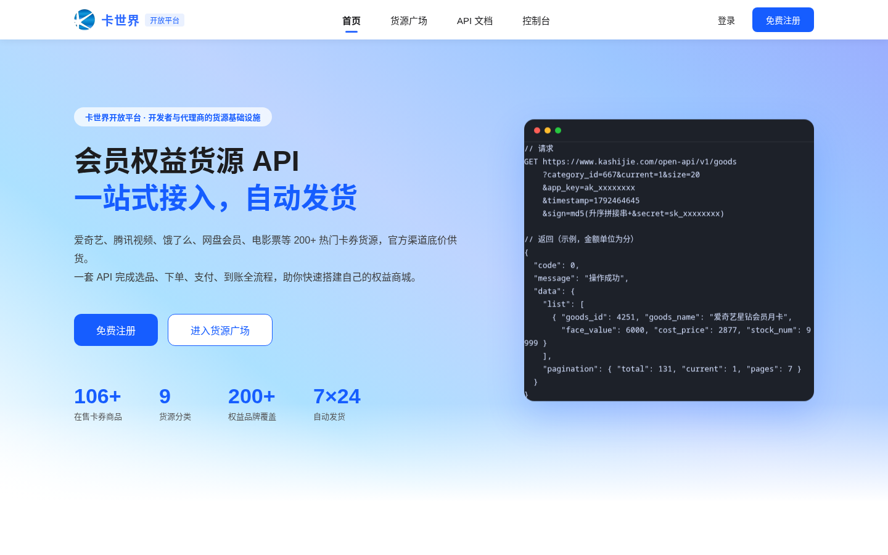
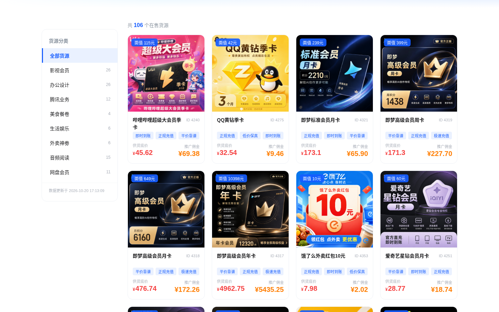
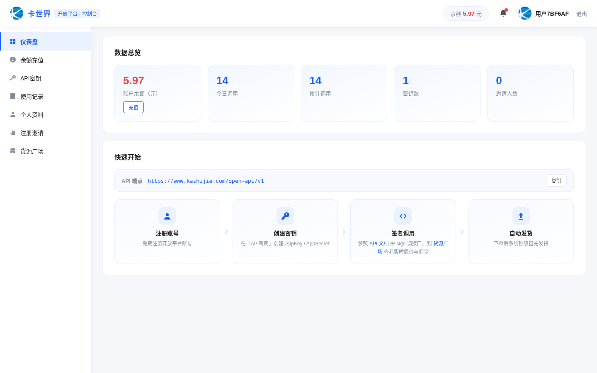
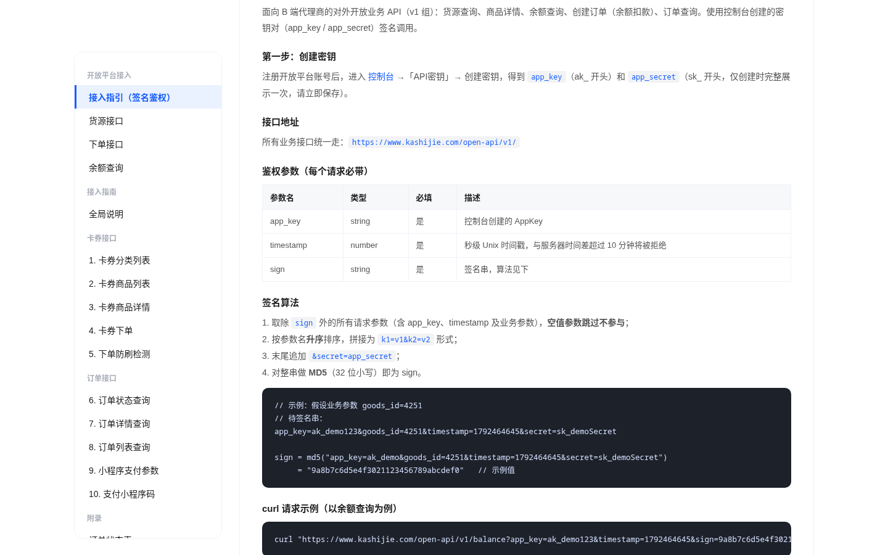

# 卡世界开放平台（kashijie-open-platform）

会员权益卡券货源 API 一站式接入的开源实现：货源查询、下单、支付、到账发货全自动，配套代理商控制台与余额充值体系。

## 这是什么

卡世界开放平台把"会员卡券货源"封装成一套标准 HTTP API，并提供完整的代理商自助体系：

- **200+ 品牌卡券货源**：音视频会员、外卖红包、电影票、酒店民宿、生活权益等，底价透明
- **全自动交易链路**：API 选品 → 余额扣款 → 供货方直充 → 到账，7×24 自动发货，失败自动退款
- **代理商控制台**：注册即用，密钥管理、调用统计、余额充值、公告、邀请，全部自助完成

项目由两部分组成：可嵌入现有 Laravel 项目的**后端业务模块**，和零构建可直接部署的**静态前端站点**（首页 / 货源市场 / 文档 / 注册登录 / 控制台）。

## 货源从哪来

本系统的卡券货源由**卡世界平台**供应。架构链路：

```
你的平台（本项目） → 卡世界供货 API（open-api v1） → 自动发货到账
```

部署方前往 [kashijie.com](https://www.kashijie.com) 注册开放平台账号、创建 API 密钥（app_key / app_secret），填入 `.env` 的 `SUPPLIER_*` 配置，即可为自己的平台接入 200+ 品牌卡券货源：成本价结算、随充随用，下单、支付、发货、失败退款全部自动完成。本项目代码只与卡世界公开 API 通信，不依赖任何内部系统。

## 核心设计

| 设计 | 说明 |
|---|---|
| 公开货源 | 货源列表/详情**无需注册即可调用**（同 IP 限 60 次/分钟防爬），降低接入门槛 |
| 签名交易 | 下单、余额、订单查询必须 app_key + 时间戳 + MD5 签名，密钥可随时禁用 |
| 加价倍数 | 每个密钥可配 `price_rate`（1.00~99.99），对外报价 = 底价 × 倍数；**平台扣款永远按真实底价** |
| 资金安全 | 余额扣款走事务 + 原子更新（`WHERE balance >= 成本`）防并发超扣；供货方发货失败自动原路退款，幂等防重 |
| 充值闭环 | 微信 Native / 支付宝当面付扫码充值，**主动查单结算**（不依赖异步回调）+ crontab 每分钟兜底 |
| 真实短信 | 注册/登录验证码走腾讯云短信，自带限频；验证码登录未注册自动开户 |

## 功能清单

**对外 API（v1）**
- 货源列表 / 商品详情（公开）
- 余额查询、创建订单、订单查询（签名）
- 订单状态实时同步供货方，失败自动退款

**平台账号（platform）**
- 资料修改、数据看板、邀请海报链接
- API 密钥全生命周期管理（创建 / 明文查看 / 启停 / 加价倍数）
- 余额充值（扫码支付 + 主动查单到账）、充值记录
- 管理端：用户管理、手动调账、充值记录、公告发布

## 技术栈

- **后端**：PHP 7.4+ / Laravel 8，MySQL；EasyWeChat（微信支付 V2）、腾讯云短信 SDK
- **前端**：原生 HTML/CSS/JavaScript 静态站点，无框架无构建
- **架构原则**：无侵入——后端模块不修改宿主 Laravel 项目的任何现有文件，路由纯追加、数据表全部独立前缀

## 目录结构

```
├── README.md
├── LICENSE                     # MIT
├── .env.example                # 全部外部化配置模板
├── docs/
│   ├── installation.md         # 部署接入指南
│   └── api.md                  # API 文档
├── sql/
│   └── schema.sql              # 建表语句（7 张 open_ 表 + 短信验证码表）
├── frontend/                   # 静态前端站点
│   ├── index.html              # 首页
│   ├── market.html             # 货源市场
│   ├── docs.html               # 在线 API 文档
│   ├── login.html / register.html
│   ├── console.html            # 代理商控制台
│   ├── open-common.css/js      # 公共样式与 API 封装（API_BASE 在此配置）
│   └── assets/                 # logo 等静态资源
└── backend/                    # Laravel 后端模块
    ├── Controllers/open/       # 平台账号 / 对外 v1 / 充值管理 三个控制器
    ├── Services/               # 卡世界供货、微信、支付宝、短信 服务
    ├── Models/                 # 短信验证码模型
    ├── Commands/               # 充值兜底查单 artisan 命令
    ├── Support/                # 最小辅助函数集（resp/订单号/curl）与响应码表
    ├── Config/                 # 支付宝配置（读 .env）
    └── routes.php              # 路由片段（追加到 routes/api.php）
```

## 快速开始

详见 [docs/installation.md](docs/installation.md)。部署方只需要准备三样东西，其余全部内置：

| 你要提供的 | 用途 | 填在哪 |
|---|---|---|
| 微信商户号（或支付宝） | 你平台上代理充值的收款，钱直接进你的商户 | `.env` 的 `OPEN_WX_*` / `ALIPAY_*` |
| 卡世界供货密钥 | 接入 200+ 品牌卡券货源，成本价结算 | `.env` 的 `SUPPLIER_*`（去 [kashijie.com](https://www.kashijie.com) 注册创建密钥即得） |
| 一台服务器 + MySQL | 跑后端模块和前端站点 | `.env` 的 `DB_*` |

> 商户号怎么申请、每个参数去哪拿、钱具体怎么流：见 [docs/payment.md](docs/payment.md)。系统没有任何内置收款账户，不配支付则收款功能关闭（接口明确报错引导配置）。

最短路径：

1. `mysql ... < sql/schema.sql` 建表
2. `backend/` 按目录拷入 Laravel 项目，`routes.php` 追加到 `routes/api.php`
3. 对照 `.env.example` 填好上面三样
4. `frontend/` 丢到静态服务器，改 `open-common.js` 顶部 `API_BASE`
5. 注册账号 → 设为管理员 → 创建密钥 → 开始调 API

## 接口一览

| 接口 | 鉴权 | 说明 |
|---|---|---|
| `GET /api/open/v1/goods` | 公开 | 货源列表 |
| `GET /api/open/v1/goods/detail` | 公开 | 商品详情 |
| `GET /api/open/v1/balance` | 签名 | 余额查询 |
| `POST /api/open/v1/order/create` | 签名 | 创建订单（余额扣款 + 自动发货） |
| `POST /api/open/v1/order/query` | 签名 | 订单查询（状态同步 + 失败退款） |
| `POST /api/open/platform/register` | - | 注册 |
| `POST /api/open/platform/login-sms` | - | 验证码登录（自动注册） |
| `POST /api/open/platform/recharge` | token | 余额充值（微信/支付宝扫码） |
| `GET /api/open/platform/dashboard` | token | 控制台数据看板 |
| `POST /api/open/platform/admin/balance` | token+管理员 | 手动调账 |

完整文档：[docs/api.md](docs/api.md)

## 截图









## License

[MIT](LICENSE)
